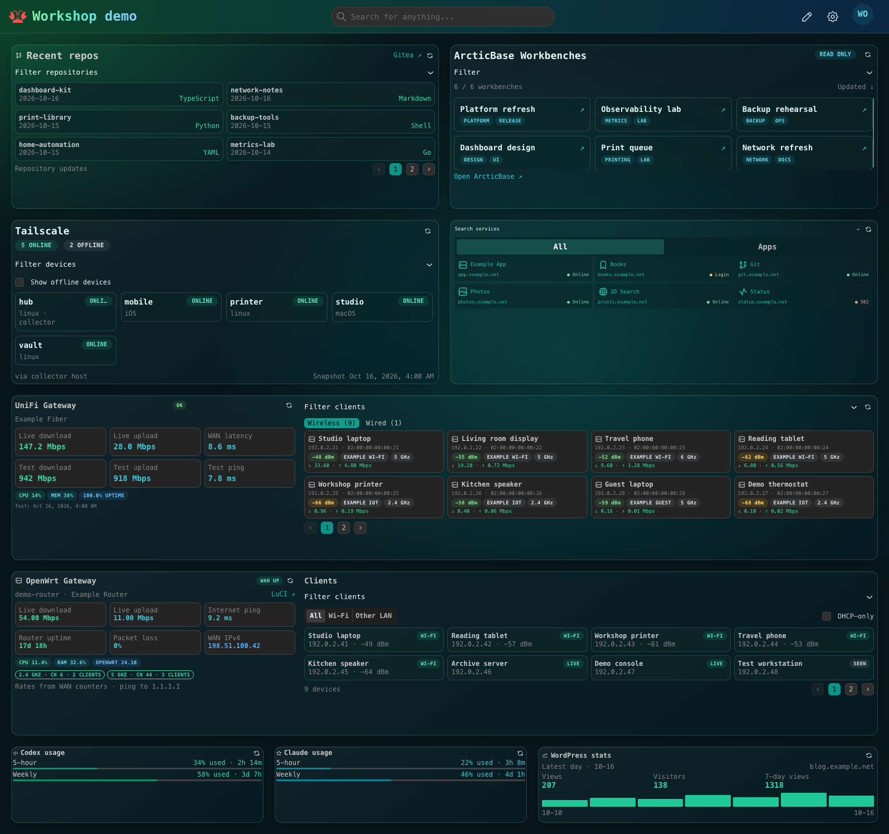
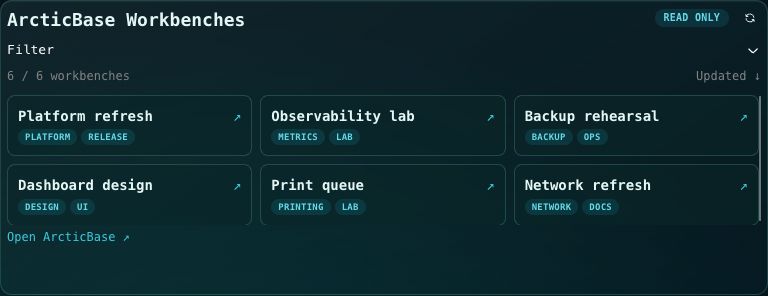
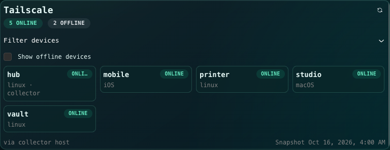
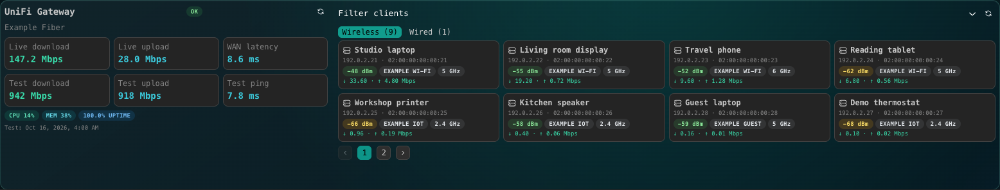
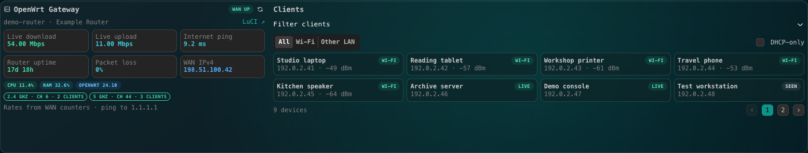
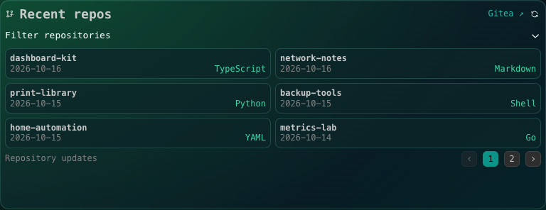
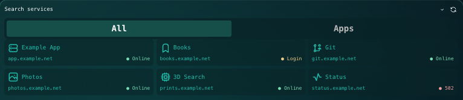
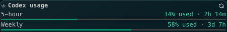
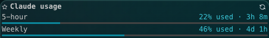
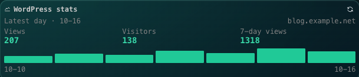

# Workshop screenshot gallery

These are actual browser captures from an isolated Homarr v2.5.2 development instance. All service names, repositories, devices, addresses, statistics and usage figures are fictional. No production dashboard or accounts were connected. Documentation domains and reserved example IP addresses are intentional.

The demo uses the included Aurora Teal theme, terminal monospace system fonts and compact service-directory CSS. Demo-only font, category-control and service-label sizing overrides improve screenshot readability. Widget captures are cropped to the rendered card or its content; the theme image shows the whole demo board. These previews demonstrate rendering with fixture responses, not live collector connectivity or provider authentication.

For each Workshop submission, attach that package's `screenshots/overview.png` using the screenshot upload field. Do not upload a configured dashboard export or demo login. Each PNG is below 1 MiB. Hermes chat, Domain manager and Guest Assistant are source-only packages and are outside this native-widget/theme screenshot set.

## Aurora Teal theme

## ArcticBase Workbenches

## Tailscale

## UniFi Gateway

## OpenWrt Gateway

## Gitea repositories

## Service directory

## Codex usage

## Claude usage

## WordPress stats

